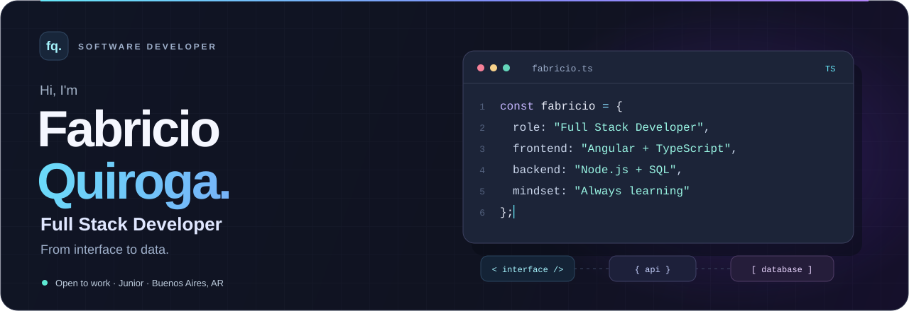
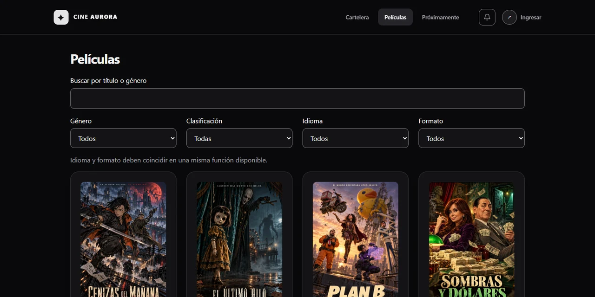
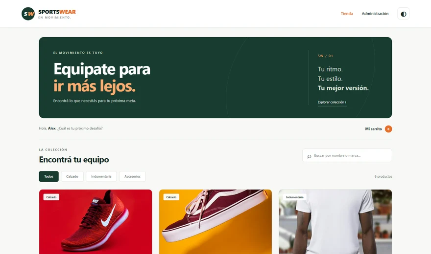
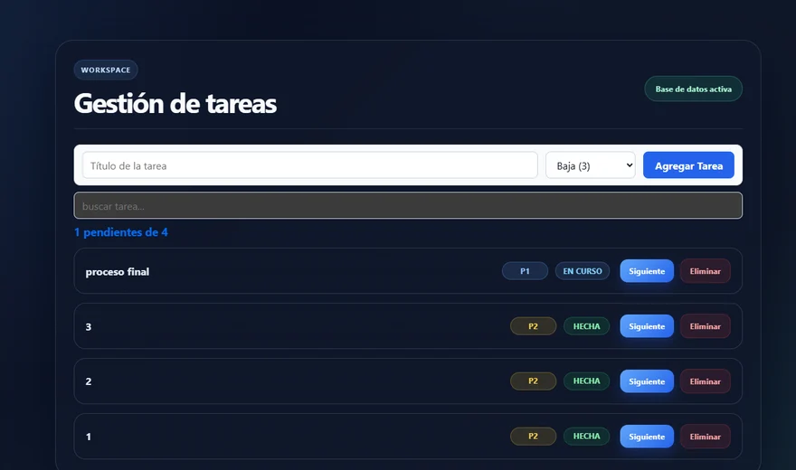
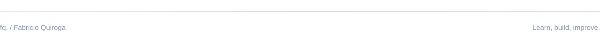

  <a href="README.md">Español</a> · <strong>English</strong>

  

  
  &nbsp;
  
  &nbsp;
  

## A little about me

I'm a **Junior Full Stack Developer** studying for a **University Technical Degree in Systems at UTN Avellaneda**. I build end-to-end web applications, connecting interfaces, APIs and databases.

- **Main focus:** Angular, TypeScript, Node.js and SQL databases.
- **Teamwork:** task planning, code reviews, Scrum and Kanban.
- **Currently learning:** AI-assisted development and cybersecurity fundamentals, including training at Fundación YPF.
- **Next step:** my first professional software development role. Available **full-time**.

📍 Quilmes, Buenos Aires, Argentina &nbsp; · &nbsp; Native Spanish / English B2

## Technologies I work with

**Frontend**

**Backend & languages**

**Databases & services**

**Tools**

<strong>More technologies & skills</strong>

 

- **Web & mobile:** React, Bootstrap, Flutter and Dart. Built a restaurant app in a team of four developers.
- **Architecture:** REST APIs, JWT authentication, object-oriented programming, MVC and client-server architecture.
- **Practices:** Clean Code, data structures, algorithms and OWASP Top 10 fundamentals.
- **AI-assisted development:** Claude Code, ChatGPT and GitHub Copilot.

## Selected projects

### 01 / Cine Aurora

**A cinema platform, from movie discovery to back-office operations.**

Movie listings, seat selection, simulated checkout, QR tickets and a role-based back office with promotions and reports. Combines a responsive interface, PostgreSQL business rules and PWA capabilities.

`Angular` `TypeScript` `Supabase` `PostgreSQL` `PWA`

**[Live demo ↗](https://cine-aurora.vercel.app)** &nbsp; · &nbsp; [Explore the code and architecture](https://github.com/fasfis544/FABRICIO-QUIROGA-TP1-PROG4-2026-C2)

 

<table>
<tr>
<td width="50%" valign="top">

### 02 / SportsWear

Sports store with product search, filters, shopping cart and an admin panel. REST API with validation, MySQL persistence and Playwright tests. Built collaboratively.

`Node.js` `Express` `JavaScript` `EJS` `MySQL`

**[Explore project ↗](https://github.com/fasfis544/tp-integrador-backend)**

</td>
<td width="50%" valign="top">

### 03 / Task manager

Create, search, edit and organize tasks by status. An Angular interface connected to Supabase for persistent storage.

`Angular` `TypeScript` `Supabase` `HTML` `CSS`

**[Explore project ↗](https://github.com/fasfis544/Gestion-de-tareas-base-en-supabase)**

</td>
</tr>
</table>

**Also in Java:** [Product management](https://github.com/fasfis544/GestionProductos), a JavaFX desktop application with filters and data import/export.

---

### Let's build something together

I'm looking for a team where I can contribute, learn and grow as a developer.

**[Connect on LinkedIn](https://www.linkedin.com/in/fabricio-quiroga-59b54b361/)** &nbsp; · &nbsp; **[fabrimq@gmail.com](mailto:fabrimq@gmail.com)**

