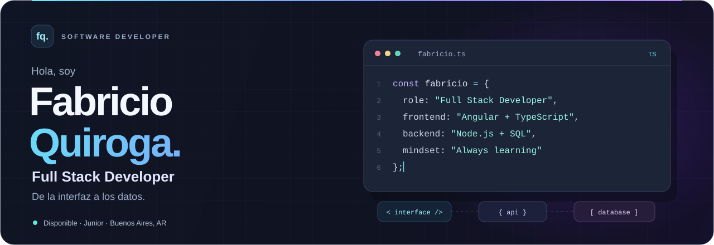
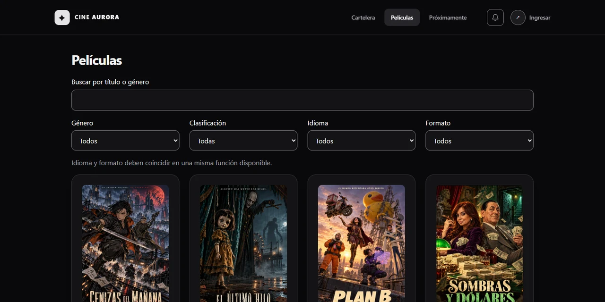
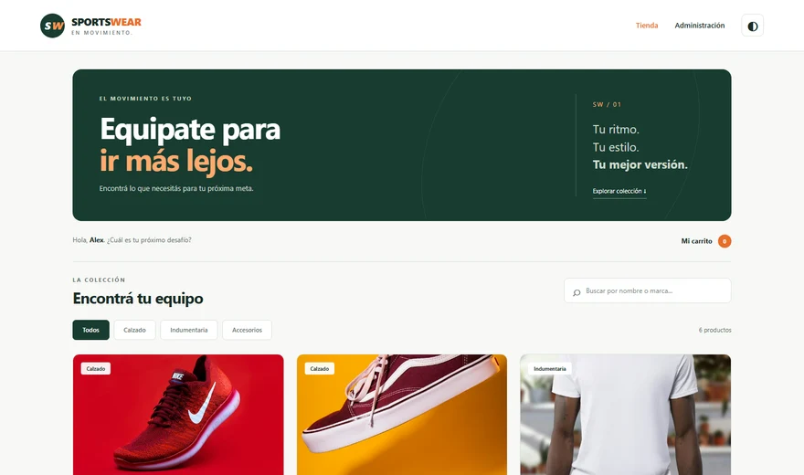
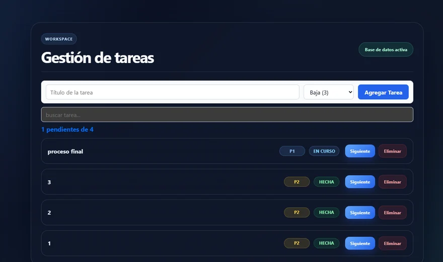
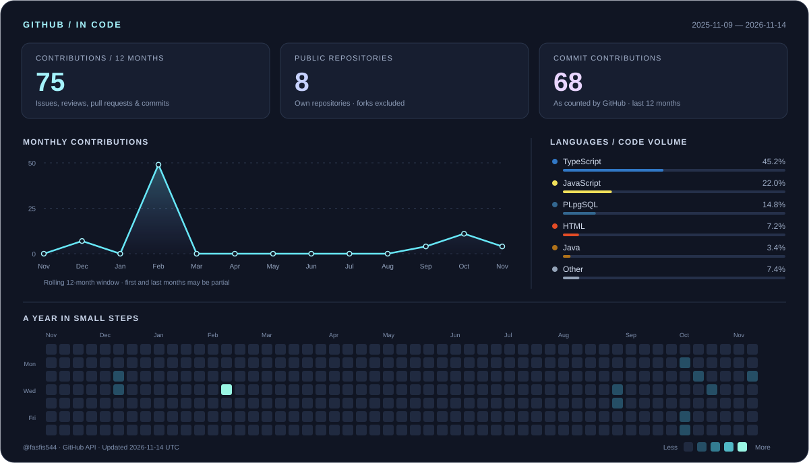
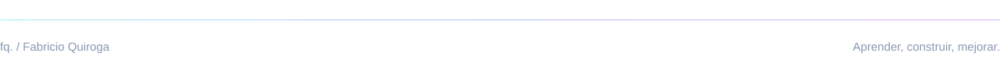

  <strong>Español</strong> · <a href="README.en.md">English</a>

  

  
  &nbsp;
  
  &nbsp;
  

## Un poco sobre mí

Soy **desarrollador Full Stack Junior** y estudiante de la **Tecnicatura Universitaria en Sistemas en UTN Avellaneda**. Desarrollo aplicaciones web de punta a punta: interfaces, APIs y bases de datos que trabajan juntas.

- **Mi foco:** Angular, TypeScript, Node.js y bases de datos SQL.
- **En equipo:** organización de tareas, revisión de código y trabajo con Scrum y Kanban.
- **Sigo aprendiendo:** IA aplicada al desarrollo y fundamentos de ciberseguridad, con formación en Fundación YPF.
- **Mi próximo paso:** mi primera oportunidad profesional en desarrollo de software. Disponibilidad **full time**.

📍 Quilmes, Buenos Aires, Argentina &nbsp; · &nbsp; Español nativo / English B2

## Tecnologías con las que trabajo

**Frontend**

**Backend y lenguajes**

**Bases de datos y servicios**

**Herramientas**

<strong>Más tecnologías y conocimientos</strong>

 

- **Web y móvil:** React, Bootstrap y desarrollo de aplicaciones con Flutter y Dart. Participé en una app para restaurante junto a otros tres desarrolladores.
- **Arquitectura:** APIs REST, autenticación JWT, programación orientada a objetos, MVC y arquitectura cliente-servidor.
- **Buenas prácticas:** Clean Code, estructuras de datos, algoritmos y fundamentos de OWASP Top 10.
- **IA como herramienta:** Claude Code, ChatGPT y GitHub Copilot.

## Proyectos destacados

### 01 / Cine Aurora

**Una plataforma de cine, desde la cartelera hasta la administración.**

Cartelera, selección de butacas, compra simulada, comprobantes QR y un backoffice con roles, promociones y reportes. Integra una interfaz responsive con reglas de negocio en PostgreSQL y una experiencia PWA.

`Angular` `TypeScript` `Supabase` `PostgreSQL` `PWA`

**[Ver demo ↗](https://cine-aurora.vercel.app)** &nbsp; · &nbsp; [Explorar el código y la arquitectura](https://github.com/fasfis544/FABRICIO-QUIROGA-TP1-PROG4-2026-C2)

 

<table>
<tr>
<td width="50%" valign="top">

### 02 / SportsWear

Tienda deportiva con catálogo, filtros, carrito y panel de administración. API REST con validaciones, persistencia en MySQL y pruebas con Playwright. Proyecto desarrollado en equipo.

`Node.js` `Express` `JavaScript` `EJS` `MySQL`

**[Explorar proyecto ↗](https://github.com/fasfis544/tp-integrador-backend)**

</td>
<td width="50%" valign="top">

### 03 / Gestión de tareas

Aplicación para crear, buscar, editar y organizar tareas por estado. Una interfaz Angular conectada a Supabase para mantener la información persistente.

`Angular` `TypeScript` `Supabase` `HTML` `CSS`

**[Explorar proyecto ↗](https://github.com/fasfis544/Gestion-de-tareas-base-en-supabase)**

</td>
</tr>
</table>

**También en Java:** [Gestión de productos](https://github.com/fasfis544/GestionProductos), una aplicación de escritorio con JavaFX, filtros e importación/exportación de datos.

## Mi actividad en GitHub

Actualización diaria con GitHub Actions. Los lenguajes se calculan por bytes de código en repositorios públicos propios, excluyendo este perfil; no representan nivel de dominio. La actividad depende de la visibilidad que ofrece GitHub.

---

### ¿Construimos algo juntos?

Busco sumarme a un equipo donde pueda aportar, aprender y seguir creciendo como desarrollador.

**[Conectemos en LinkedIn](https://www.linkedin.com/in/fabricio-quiroga-59b54b361/)** &nbsp; · &nbsp; **[fabrimq@gmail.com](mailto:fabrimq@gmail.com)**

